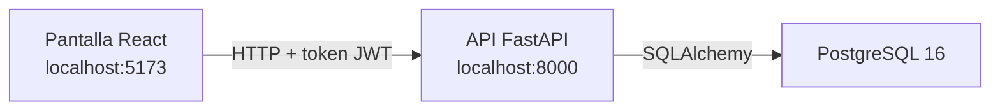
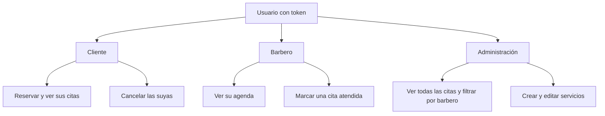
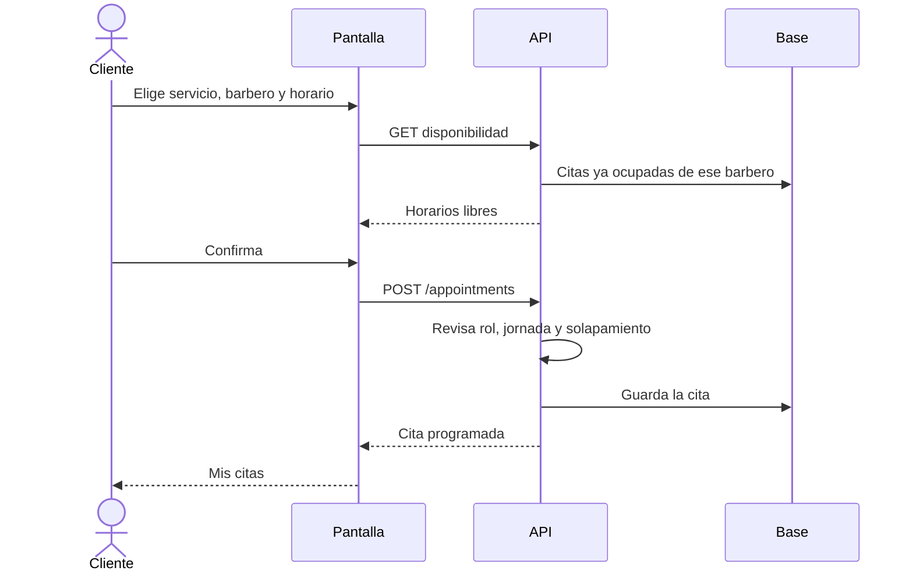
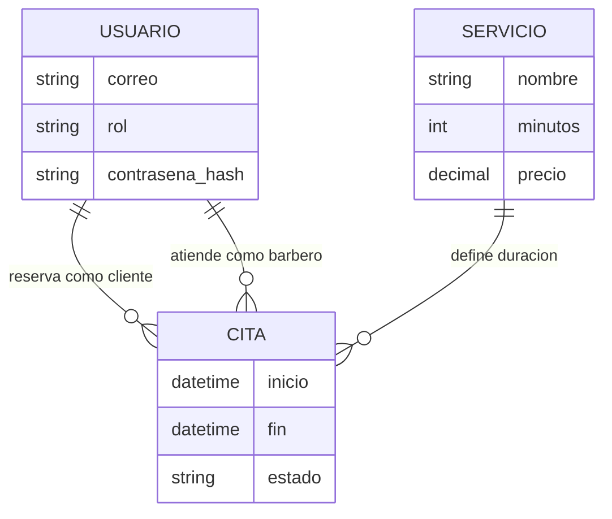

# Barbería Norte: qué hace el sistema

Barbería Norte es una aplicación web para reservar citas en una barbería. El cliente elige servicio, barbero y horario. El barbero ve sus citas y las marca como atendidas. La administración ve toda la agenda y administra los servicios.

La pantalla no decide las reglas. Pregunta al servidor, y el servidor es el que acepta o rechaza según el rol, el horario y si ese barbero ya está ocupado.

## Tres piezas

| Pieza | Tecnología | Para qué sirve |
| --- | --- | --- |
| Pantalla | React, TypeScript, Vite | Registro, reserva, mis citas, agenda y servicios |
| Servidor | FastAPI, Pydantic | Horarios, permisos y citas. Contrato en `/docs` |
| Base de datos | PostgreSQL 16, SQLAlchemy, Alembic | Usuarios, servicios y citas. El esquema va versionado |
| Sesión | JWT y bcrypt | El login devuelve un token con el id y el rol. La contraseña se guarda cifrada |
| Hora | America/Mexico_City | La jornada es de lunes a sábado, 09:00 a 18:00 |

En local, PostgreSQL corre con Docker Compose. Al arrancar, la API aplica las migraciones y, si hace falta, carga la semilla: administración, Mateo Ruiz, Leo Vargas, y los servicios Corte (30 min), Barba (30 min), Corte y barba (60 min) y Cejas (15 min).

## Quién entra y qué puede hacer

El registro público solo crea clientes. Barberos y administración ya vienen en la semilla.

| Pantalla | Quién | Qué hace |
| --- | --- | --- |
| `/registro` y `/login` | Cualquiera | Crea la cuenta o entra |
| `/reservar` | Cliente | Servicio, barbero, horario y confirmación |
| `/mis-citas` | Cliente | Lista sus citas y permite cancelar las programadas |
| `/agenda` | Barbero y administración | Muestra todas las citas. Se puede filtrar por fecha |
| `/servicios` | Administración | Alta y edición de servicios |

Una cita tiene tres estados: programada, cancelada o atendida.

## Cómo se reserva una cita

El servidor arma los huecos del día según la duración del servicio. Un corte de 30 minutos y uno de 60 no ocupan los mismos bloques. El domingo no tiene horarios. Si el intervalo ya está tomado, la API responde 409 y no guarda la segunda cita. Si alguien intenta cancelar la cita de otro, responde 403.

La agenda del barbero lista sus citas, de la más reciente a la más antigua, agrupadas por día. **Filtrar por fecha** deja un solo día. **Ver todas** quita el filtro. La administración puede, además, elegir un barbero.

## Qué se guarda

Las horas se guardan con zona horaria. Así el día de la cita es el mismo en la base, en la API y en la pantalla.

## Cómo se comprueba

Cada capa tiene su prueba. No hace falta detallarlas aquí: el recorrido está en `docs/guion-pruebas.md`.

| Prueba | Herramienta | Qué mira |
| --- | --- | --- |
| Unitaria | pytest y Vitest | Reglas sueltas: horarios, solapamiento, contraseña, formularios |
| Integración | pytest y Testcontainers | API y un PostgreSQL real: guardar la cita, el 409 y el 403 |
| Extremo a extremo | Cypress | El cliente reserva y cancela; el barbero ve la cita en la agenda |
| Carga | k6 | 10 consultas a la vez, 30 segundos, con tope de errores y de tiempo |

GitHub Actions vuelve a correr esas cuatro pruebas en cada cambio.
